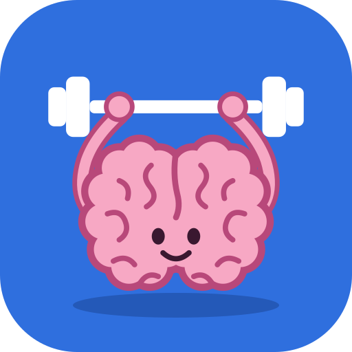
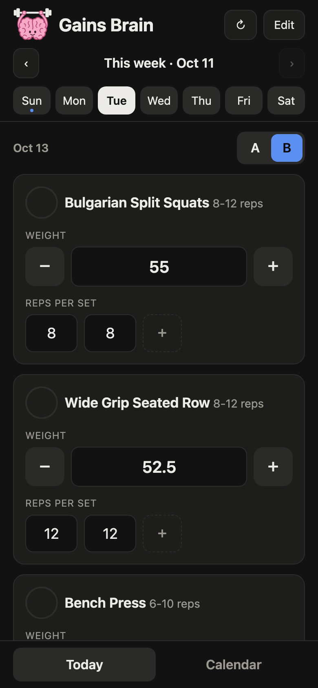
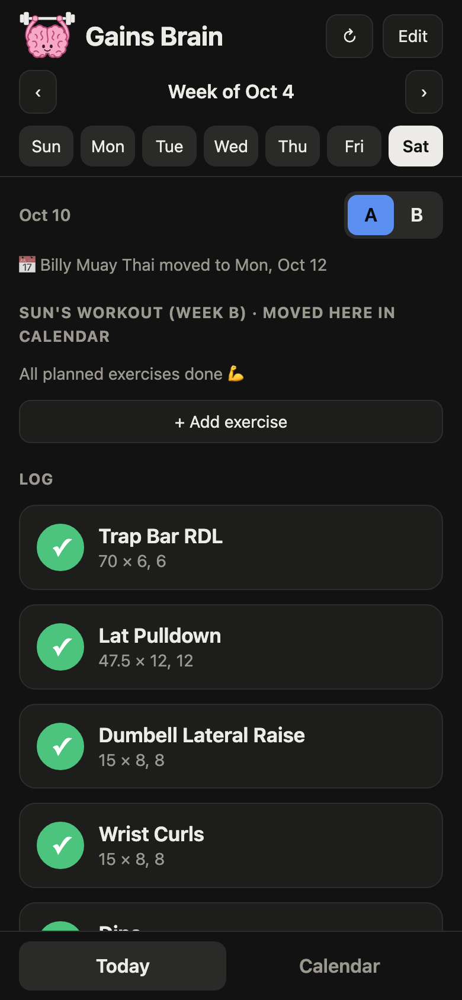
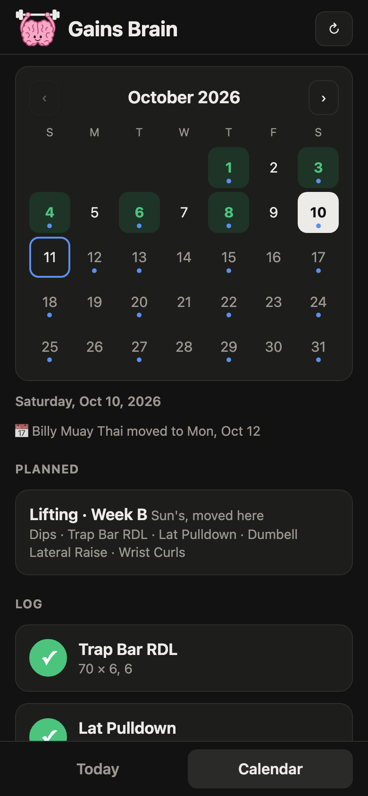

<p align="center"></p>

# Gains Brain

A small mobile web app for tracking my workout plan, weights, and reps. It reads workout moves from Google Calendar.

<p align="center">
  
  
  
</p>

## Run

```
python3 server.py
```

Then open the printed address on your phone (same Wi-Fi). Needs Python 3.9+ and nothing else.

On iPhone, open it in Safari and tap Share → Add to Home Screen. It opens full-screen like an app.

## Files

- `index.html`: the app
- `server.py`: serves the app, saves data, and reads the calendar
- `manifest.webmanifest`, `icon-*.png`: Home Screen app name and icons (`icon.svg` is the source)
- `docs/logo.svg`, `docs/screenshots/`: the logo and screenshots above
- `seed.json`: the starting plan, used when `data.json` doesn't exist yet
- `data.json`: your plan and log (created on first save, not in git). See `data.example.json` for the format.
- `calendar_url.txt`: optional Google Calendar secret iCal address (not in git). Copy `calendar_url.example.txt` and paste in your own.
